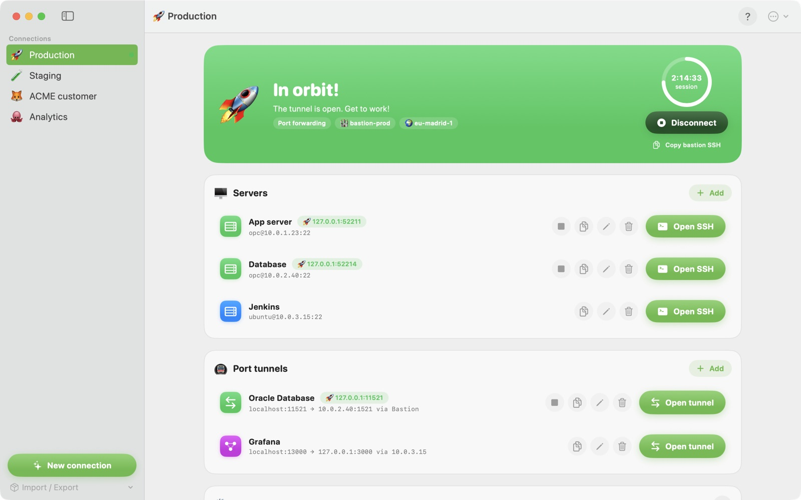
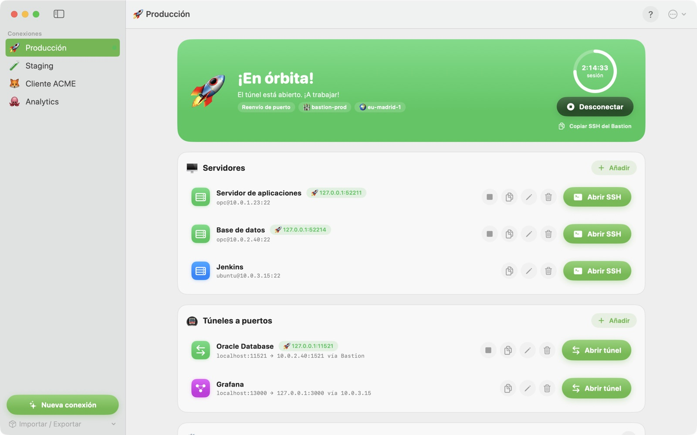

# Bastionaut

**English** · [Español](#español)

Bastionaut is a macOS app that opens SSH tunnels to private Oracle Cloud machines through the OCI Bastion service — no commands to type.

Original author: [Israel Gutiérrez](https://github.com/israelgoracle/OCIBastion_MacOs) · Improvements: Javier Mugueta.

🌐 Website: https://javiermugueta.github.io/bastionaut/ · [Support](https://javiermugueta.github.io/bastionaut/support.html) · [Privacy](https://javiermugueta.github.io/bastionaut/privacy.html)



## Features

- **Guided setup**: paste the configuration snippet from the OCI console, and the assistant finds your bastions across the whole tenancy (OCI Search).
- **Two session types**: SOCKS5 (one tunnel for every server; needs "FQDN and SOCKS5" on the bastion) or managed port forwarding (one session per server; works with any bastion).
- **Self-maintaining tunnels**: reuses active sessions, renews them before they expire (30 min ahead by default) and reconnects if the network drops.
- **One click**: "Open SSH" opens Terminal or iTerm2 already connected; port tunnels bring a database or web console to `localhost`, straight through the bastion or via an SSH server.
- **Explains failures**: detects when your IP isn't on the bastion's allowed list, gives a tip for every error and keeps an activity log.
- **Secure**: talks straight to the OCI REST API (no OCI CLI or Python), keeps the API key in the macOS Keychain, uses temporary per-session bastion keys and runs in the macOS sandbox. No data is collected.
- **Demo mode**: *Help › Try with sample data* lets anyone (including App Review) try the app without an OCI account.
- English and Spanish, Dark Mode, built-in help (⌘?).

## Requirements

The in-app help (**Help › Bastionaut Help**, ⌘?) covers them in detail under **Requirements**.

**On your Mac**
- macOS 14 Sonoma or later.
- Terminal or iTerm2. The first time, allow the **Automation** permission so the app can open SSH sessions.
- Optional corporate HTTP CONNECT proxy (auto-detected from `http_proxy`, system settings or WPAD, or set by hand).

**OCI account**
- An RSA API key registered on your user (OCI console › your profile › API keys). The assistant asks for tenancy, user, region and the private key (`.pem` file or pasted). The fingerprint is computed for you and the key is stored in the Keychain.

**Bastion**
- An active bastion in the region whose target subnet reaches your servers, with security lists allowing traffic from it.
- Your public IP (or your proxy/VPN egress IP) on the bastion's allowed IP list.
- For SOCKS5 mode, "FQDN and SOCKS5" enabled. Port forwarding mode works with any bastion.

**IAM permissions** (example; adjust group and compartment):

```
Allow group BastionUsers to use bastion in compartment MyCompartment
Allow group BastionUsers to manage bastion-session in compartment MyCompartment
Allow group BastionUsers to read virtual-network-family in compartment MyCompartment
Allow group BastionUsers to read instance-family in compartment MyCompartment
```

**Servers**
- A user (`opc` on Oracle Linux, `ubuntu` on Ubuntu…) and a private SSH key authorized on the server.

## Build and run

```sh
./Scripts/build-app.sh
open "dist/Bastionaut.app"
```

Builds are release, universal (arm64 + x86_64), sandboxed, and signed with your **Apple Development** certificate if you have one (a stable identity, so the Keychain and the data folder don't ask again after every build), otherwise ad hoc. Quick debug build: `CONFIGURATION=debug ./Scripts/build-app.sh`.

The source icon is `Assets/AppIcon.png`; run `Scripts/build-icon.sh` to regenerate `Assets/AppIcon.icns`.

## Tests

```sh
./Scripts/test.sh                                    # unit tests
OCIB_LIVE=1 ./Scripts/test.sh --filter LiveOCITests  # read-only calls against real OCI (DEFAULT profile of ~/.oci/config, or OCIB_PROFILE)
```

## Distribution

There is **one version** of the app, always sandboxed; only the signature changes per channel.

- **Mac App Store**: `PROVISIONING_PROFILE=~/.private_keys/<profile>.provisionprofile ./Scripts/appstore.sh` builds into `dist/appstore/` (that copy can't be opened locally), signs with Apple Distribution, creates the `.pkg`, validates it, uploads it to App Store Connect and waits for Apple's processing verdict. Uploading doesn't publish anything. The App Store Connect API key goes in `~/.private_keys/AuthKey_<ID>.p8`, and its IDs in an untracked `.appstore.env` (`ASC_KEY_ID=…`, `ASC_ISSUER_ID=…`).
- **Outside the store** (Developer ID, notarized `.dmg`): `VERSION=1.0 ./Scripts/release.sh`. One-time setup: a **Developer ID Application** certificate and notarization credentials in the Keychain (`xcrun notarytool store-credentials OCIBastion-notary …`, an App Store Connect API key works best). It produces `dist/Bastionaut-<version>.dmg`, notarized and stapled, and prints its SHA-256.

When moving to the sandbox, `Assets/container-migration.plist` makes macOS move data from earlier versions (`~/Library/Application Support/OCIBastion`) into the app's container.

**Store listing**: texts, review notes and privacy policy in `Store/metadata.md` (English and Spanish; `Scripts/check-metadata.py` checks Apple's limits). Screenshots in `Store/screenshots/`, regenerated with `./Scripts/screenshots.sh` using demo data. The product pages live in `docs/` (GitHub Pages).

## Localization

The app is in **English and Spanish** and follows the system language (English for any other language). Strings live in `Assets/Localizable.xcstrings` (Spanish is the source language; editable in Xcode). After adding or changing strings in code:

```sh
./Scripts/update-strings.sh   # extracts strings with the compiler and syncs the catalog
```

Then translate the new entries; `build-app.sh` compiles them into `en.lproj` and `es.lproj`. To try another language without changing the system: `open "dist/Bastionaut.app" --args -AppleLanguages '(es)'`.

## Source layout and local data

The Swift app is in `Sources/OCIBastion`, resources in `Assets`, scripts in `Scripts`, anonymized fixtures in `Tests`, store material in `Store` and the website in `docs`. Build output (`.build`, `dist`), keys, profiles and local fixtures are not tracked.

Each user brings their own API key (kept in the Keychain) and SSH keys (the app keeps a private copy in its container, `~/Library/Containers/com.javiermugueta.ocibastion`).

---

## Español

[English](#bastionaut) · **Español**

Bastionaut es una app de macOS que abre túneles SSH hacia máquinas privadas de Oracle Cloud a través del servicio OCI Bastion, sin escribir comandos.

Autor original: [Israel Gutiérrez](https://github.com/israelgoracle/OCIBastion_MacOs) · Mejoras: Javier Mugueta.

🌐 Web: https://javiermugueta.github.io/bastionaut/?lang=es · [Soporte](https://javiermugueta.github.io/bastionaut/support.html?lang=es) · [Privacidad](https://javiermugueta.github.io/bastionaut/privacy.html?lang=es)



### Funciones

- **Configuración guiada**: pega el fragmento de configuración de la consola de OCI y el asistente busca tus bastiones en toda la tenancy (OCI Search).
- **Dos tipos de sesión**: SOCKS5 (un túnel para todos los servidores; requiere «FQDN y SOCKS5» en el Bastion) o reenvío de puerto gestionado (una sesión por servidor; funciona con cualquier Bastion).
- **Túneles que se cuidan solos**: reutiliza sesiones activas, las renueva antes de que caduquen (30 min antes por defecto) y reconecta si cae la red.
- **Un clic**: «Abrir SSH» abre Terminal o iTerm2 ya conectado; los túneles a puertos llevan una base de datos o una consola web a `localhost`, directamente por el Bastion o a través de un servidor SSH.
- **Explica los fallos**: detecta si tu IP no está en la lista de permitidas del Bastion, da un consejo para cada error y lleva una bitácora.
- **Seguro**: habla directamente con la API REST de OCI (sin OCI CLI ni Python), guarda la clave de API en el Llavero, usa claves temporales por sesión para el Bastion y funciona dentro del sandbox de macOS. No recopila datos.
- **Modo demostración**: *Ayuda › Probar con datos de ejemplo* permite probar la app sin cuenta de OCI (también al equipo de revisión de Apple).
- Español e inglés, modo oscuro y ayuda integrada (⌘?).

### Requisitos

La ayuda de la app (**Ayuda › Ayuda de Bastionaut**, ⌘?) los explica con detalle en el tema **Requisitos**.

**En tu Mac**
- macOS 14 Sonoma o posterior.
- Terminal o iTerm2. La primera vez, acepta el permiso de **Automatización** para que la app abra las sesiones SSH.
- Proxy corporativo HTTP CONNECT opcional (se detecta solo a partir de `http_proxy`, los ajustes del sistema o WPAD, o se indica a mano).

**Cuenta de OCI**
- Una clave de API RSA registrada en tu usuario (consola de OCI › tu perfil › Claves de API). El asistente pide tenancy, usuario, región y la clave privada (archivo `.pem` o pegada). La huella se calcula sola y la clave se guarda en el Llavero.

**Bastion**
- Un Bastion activo en la región, con subred de destino que llegue a tus servidores y listas de seguridad que permitan el tráfico desde él.
- Tu IP pública (o la de salida de tu proxy o VPN) en la lista de IPs permitidas del Bastion.
- Para el modo SOCKS5, «FQDN y SOCKS5» activado. El modo reenvío de puerto funciona con cualquier Bastion.

**Permisos IAM** (ejemplo; ajusta grupo y compartimento):

```
Allow group BastionUsers to use bastion in compartment MiCompartimento
Allow group BastionUsers to manage bastion-session in compartment MiCompartimento
Allow group BastionUsers to read virtual-network-family in compartment MiCompartimento
Allow group BastionUsers to read instance-family in compartment MiCompartimento
```

**Servidores**
- Un usuario (`opc` en Oracle Linux, `ubuntu` en Ubuntu…) y una clave SSH privada autorizada en el servidor.

### Compilar y abrir

```sh
./Scripts/build-app.sh
open "dist/Bastionaut.app"
```

Se compila en release, universal (arm64 + x86_64), con sandbox y firmada con tu certificado **Apple Development** si lo tienes (identidad estable: el Llavero y la carpeta de datos no vuelven a pedir permiso tras cada compilación); si no, con firma ad hoc. Compilación rápida de depuración: `CONFIGURATION=debug ./Scripts/build-app.sh`.

El icono fuente está en `Assets/AppIcon.png`; `Scripts/build-icon.sh` regenera `Assets/AppIcon.icns`.

### Tests

```sh
./Scripts/test.sh                                    # tests unitarios
OCIB_LIVE=1 ./Scripts/test.sh --filter LiveOCITests  # lecturas reales contra OCI (perfil DEFAULT de ~/.oci/config, u OCIB_PROFILE)
```

### Distribución

Hay **una sola versión** de la app, siempre con sandbox; solo cambia la firma según el canal.

- **Mac App Store**: `PROVISIONING_PROFILE=~/.private_keys/<perfil>.provisionprofile ./Scripts/appstore.sh` compila en `dist/appstore/` (esa copia no se puede abrir en local), firma con Apple Distribution, crea el `.pkg`, lo valida, lo sube a App Store Connect y espera el veredicto del procesado de Apple. Subir no publica nada. La clave de API de App Store Connect va en `~/.private_keys/AuthKey_<ID>.p8` y sus identificadores en un `.appstore.env` que no se sube a Git (`ASC_KEY_ID=…`, `ASC_ISSUER_ID=…`).
- **Fuera de la tienda** (Developer ID, `.dmg` notarizado): `VERSION=1.0 ./Scripts/release.sh`. Una sola vez: certificado **Developer ID Application** y credenciales de notarización en el Llavero (`xcrun notarytool store-credentials OCIBastion-notary …`; lo más cómodo es una clave de API de App Store Connect). Genera `dist/Bastionaut-<versión>.dmg`, notarizado y con el ticket grapado, e imprime su SHA-256.

Al pasar a sandbox, `Assets/container-migration.plist` hace que macOS mueva los datos de versiones anteriores (`~/Library/Application Support/OCIBastion`) al contenedor de la app.

**Ficha de la tienda**: textos, notas para la revisión y política de privacidad en `Store/metadata.md` (en inglés y español; `Scripts/check-metadata.py` comprueba los límites de Apple). Capturas en `Store/screenshots/`, que se regeneran con `./Scripts/screenshots.sh` usando datos de demostración. Las páginas web están en `docs/` (GitHub Pages).

### Idiomas

La app está en **español e inglés** y sigue el idioma del sistema (inglés para cualquier otro). Los textos están en `Assets/Localizable.xcstrings` (el español es el idioma de origen; se puede editar en Xcode). Si añades o cambias textos en el código:

```sh
./Scripts/update-strings.sh   # extrae los textos con el compilador y sincroniza el catálogo
```

Después traduce las entradas nuevas; `build-app.sh` las compila en `en.lproj` y `es.lproj`. Para probar otro idioma sin cambiar el del sistema: `open "dist/Bastionaut.app" --args -AppleLanguages '(en)'`.

### Código fuente y datos locales

La app Swift está en `Sources/OCIBastion`, los recursos en `Assets`, los scripts en `Scripts`, los ejemplos anonimizados en `Tests`, el material de la tienda en `Store` y la web en `docs`. No se suben a Git los resultados de compilación (`.build`, `dist`), claves, perfiles ni los datos de prueba locales.

Cada usuario aporta su propia clave de API (guardada en el Llavero) y sus claves SSH (la app guarda una copia privada en su contenedor, `~/Library/Containers/com.javiermugueta.ocibastion`).
